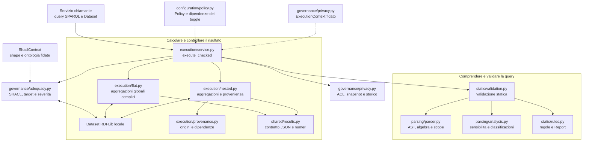
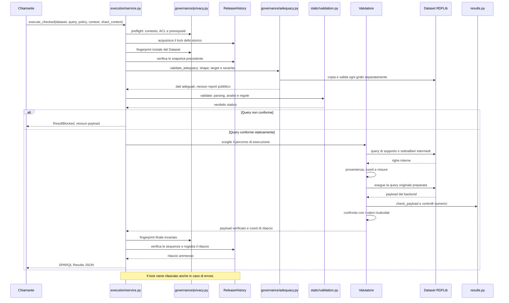
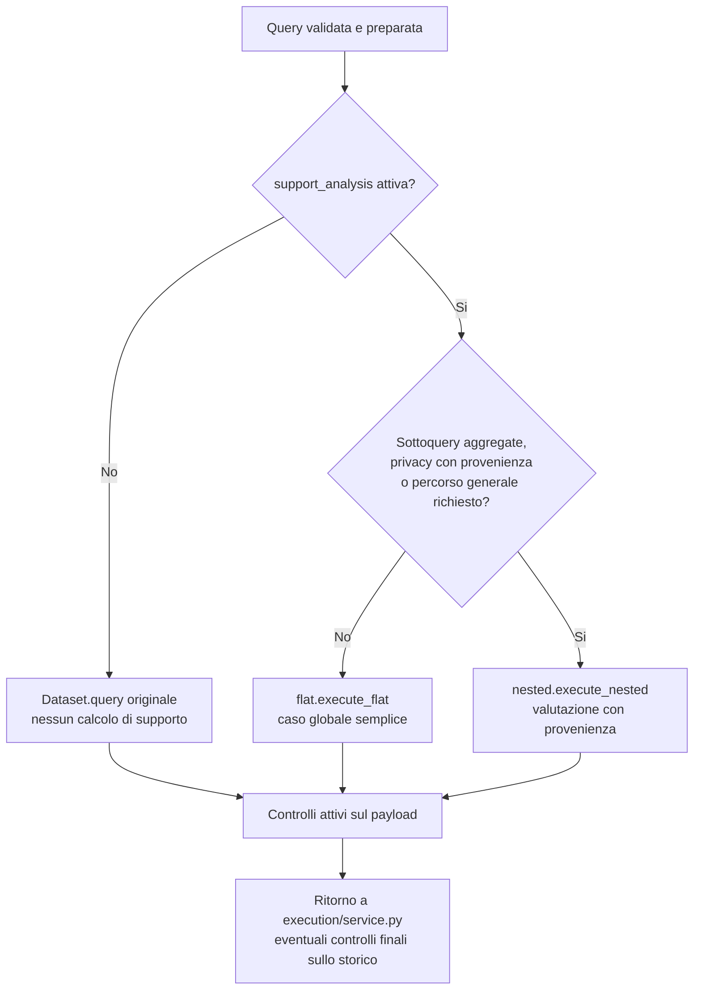
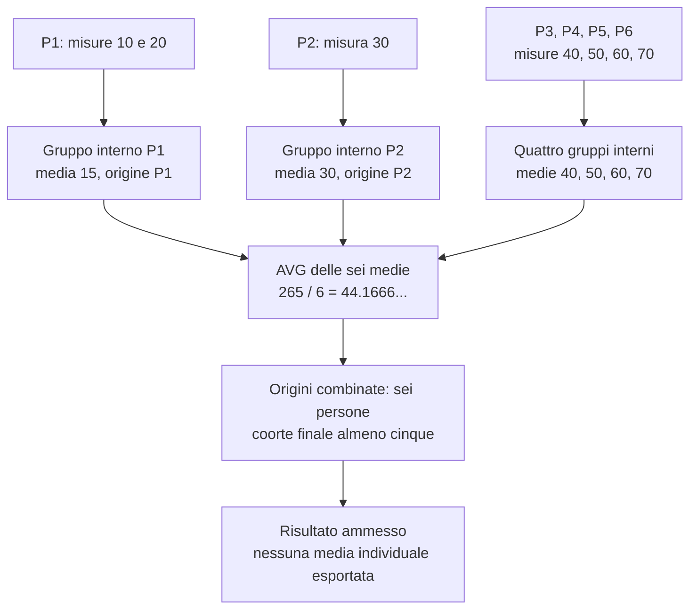
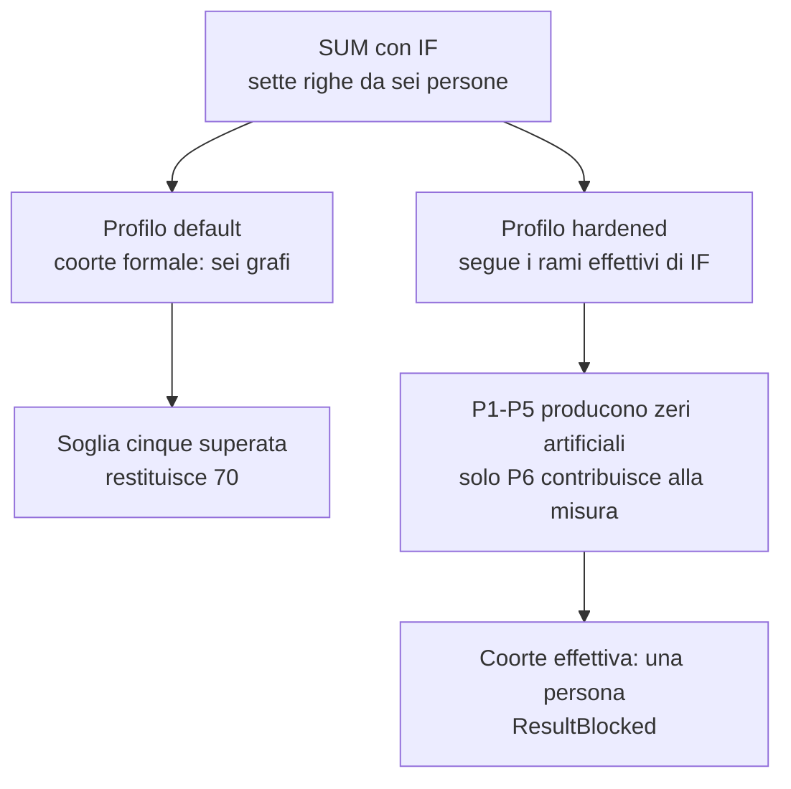
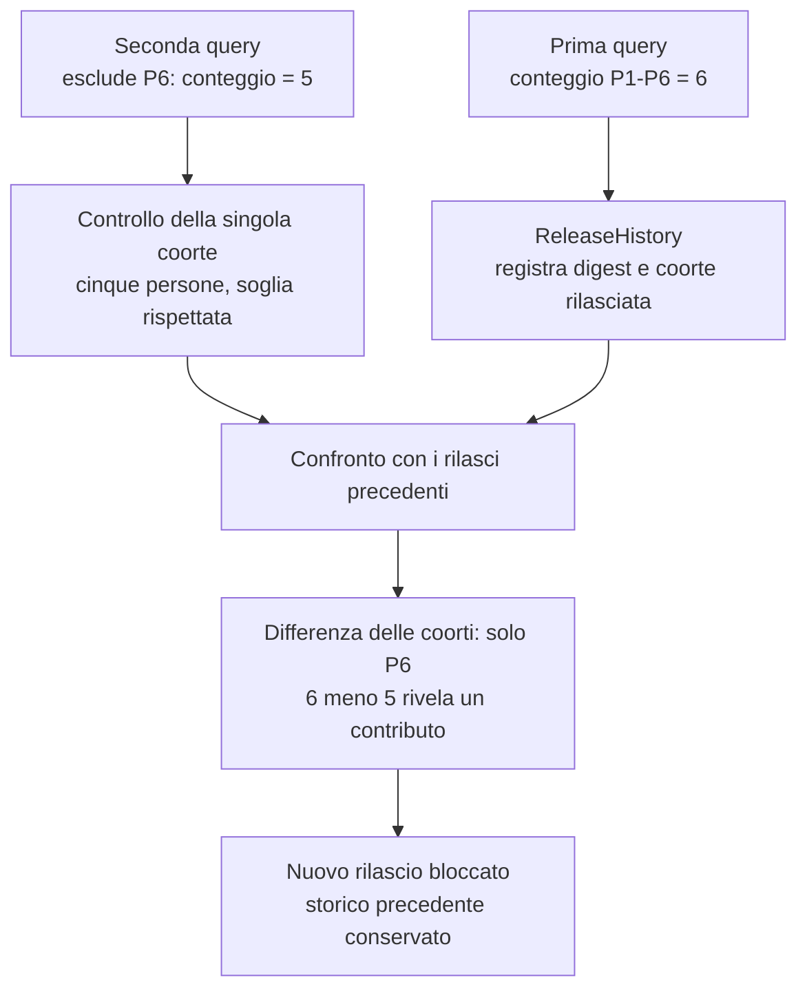

# Capire la codebase: dal testo SPARQL al risultato verificato

Questa guida accompagna una presentazione ai compagni. Parti dalla mappa dei
moduli, segui una richiesta e usa gli esempi numerici per spiegare la privacy.
I diagrammi descrivono il codice attuale di `sparql_analyzer`, non una futura
integrazione con un agente che traduce linguaggio naturale in SPARQL.

Il controllore esegue query su un **Dataset RDFLib locale**. Virtuoso e gli script
di caricamento appartengono allo stesso repository, ma `infra/virtuoso/scripts/query.sh` interroga
direttamente Virtuoso e non passa da `execute_checked`.

## 1. Chi fa cosa

Le frecce indicano responsabilita e chiamate principali. L'ordine temporale
delle verifiche e nel diagramma successivo. Le frecce tratteggiate indicano
configurazione e metadati forniti dal chiamante.



| Punto da conoscere | File e funzione | Responsabilita |
|---|---|---|
| Configurazione | [policy.py](../../src/sparql_analyzer/configuration/policy.py), `Policy` | Toggle per richiesta, limiti e dipendenze; nessun flag globale mutabile |
| Parsing | [parser.py](../../src/sparql_analyzer/parsing/parser.py), `analyze` | Produce AST, algebra serializzata e query preparata; separa le variabili locali delle sottoquery |
| Analisi | [analysis.py](../../src/sparql_analyzer/parsing/analysis.py), `QueryAnalysis` | Riconosce variabili sensibili, misure numeriche e risultati derivati da aggregati |
| Verdetto statico | [validation.py](../../src/sparql_analyzer/static/validation.py), `validate` | Applica [rules.py](../../src/sparql_analyzer/static/rules.py); restituisce findings e configurazione effettiva senza eseguire la query |
| API di esecuzione | [runtime.py](../../src/sparql_analyzer/execution/service.py), `execute_checked` | Coordina contesto, validazione, valutatore e rilascio finale |
| Valutatori | [flat.py](../../src/sparql_analyzer/execution/flat.py), `execute_flat`; [nested.py](../../src/sparql_analyzer/execution/nested.py), `execute_nested` | Calcolano supporto, aggregati e confronto con il risultato originale |
| Provenienza | [provenance.py](../../src/sparql_analyzer/execution/provenance.py), `Row`, `effective_sources` | Mantiene origini per variabile e dipendenze dei singoli aggregati |
| Confine di rilascio | [results.py](../../src/sparql_analyzer/shared/results.py), `check_payload`, `number` | Verifica forma del payload, tipi, formati e limiti numerici attivi |
| Contesto e memoria | [privacy.py](../../src/sparql_analyzer/governance/privacy.py), `ExecutionContext`, `ReleaseHistory` | ACL e mapping fidati, storico condiviso e fingerprint del Dataset |
| Adeguatezza dei dati | [adequacy.py](../../src/sparql_analyzer/governance/adequacy.py), `ShaclContext`, `validate_adequacy` | SHACL Core/SPARQL per grafo, target effettivi, meta-schema e severita |

[vocabulary.py](../../src/sparql_analyzer/shared/vocabulary.py) raccoglie il vocabolario RDF e
gli operatori riconosciuti; [algebra.py](../../src/sparql_analyzer/shared/algebra.py) contiene
visite condivise dell'albero. [compliance.py](../../src/sparql_analyzer/compliance.py)
mantiene l'API precedente e avvia la CLI definita in [cli.py](../../src/sparql_analyzer/cli.py).

## 2. Una richiesta, dall'ingresso all'uscita

Questo diagramma segue una richiesta riuscita con `Policy.hardened()`. Mostra
anche dove si ferma una query rifiutata staticamente. Ogni altra verifica puo
sollevare `ResultBlocked`: il payload non viene restituito al chiamante.



Il verdetto `is_compliant` di `validate` riguarda solo la parte statica. Non
dimostra da solo che l'utente sia autorizzato, che ci siano abbastanza persone
o che lo storico permetta un nuovo rilascio. Il servizio deve usare l'API di
esecuzione per applicare anche questi controlli.
Con hardened e richiesta anche l'adeguatezza dei dati con un `ShaclContext`
fidato: la validazione SHACL non prova la privacy o la correttezza clinica
della domanda. Vedi [configurazione e limiti SHACL](../policies/adequacy-shacl.md).

## 3. Come viene scelto il valutatore

`nested.py` e usato anche per query senza sottoquery quando servono le nuove
analisi di provenienza. Il suo nome non significa quindi che venga chiamato
esclusivamente in presenza di SELECT annidate.



Il percorso generale viene selezionato se esiste un aggregato dentro una
sottoquery, se e attiva almeno una fra `privacy_effective_contributors`,
`privacy_distinct_persons`, `privacy_query_history`, oppure se e disattivata una
delle restrizioni `runtime_single_graph`, `runtime_global_group`,
`runtime_expressions`, `runtime_distinct_star`, `runtime_aggregates`.
Queste condizioni corrispondono al dispatcher in `runtime._execute_checked`.

Disattivare `support_analysis` disattiva per dipendenza anche i controlli che
la richiedono. Le regole statiche e i controlli sul payload possono restare
attivi. Anche in questo percorso il codice non esegue SPARQL Update e non
esporta grafi CONSTRUCT/DESCRIBE.

## 4. Perche i risultati individuali intermedi sono permessi

Esempio didattico: sei persone canoniche distinte e una soglia finale di cinque.
Le misure sono sintetiche, indipendenti dalla fixture a otto persone del corpus
avversario. Si calcola prima una media per persona e poi la media tra persone.



```sparql
PREFIX sphn: <https://biomedit.ch/rdf/sphn-schema/sphn#>
SELECT (AVG(?patientAverage) AS ?cohortAverage)
WHERE {
  {
    SELECT (AVG(?value) AS ?patientAverage)
    WHERE { GRAPH ?g { ?quantity sphn:hasValue ?value } }
    GROUP BY ?g
  }
}
```

P1 ha due misure ma pesa come ogni altra persona. Appiattire i livelli darebbe
la media delle sette misure, cioe `280 / 7 = 40`, che e una statistica diversa.
La variabile `?g` puo restare privata nella sottoquery. I gruppi intermedi da
una persona non sono automaticamente soppressi: il controllo segue le origini
fino al risultato osservabile.

In `Row`, `origins` conserva le persone da cui dipende ciascuna variabile;
`dependencies` mantiene distinte le coorti degli aggregati usati nelle
espressioni finali; `controls` conserva le dipendenze di controllo tracciate.
Il confronto numerico con l'esecuzione originale evita di cambiare la semantica
della query durante questi calcoli.

Verifiche nel codice: [test delle aggregazioni annidate](../../tests/runtime/test_nested_aggregates.py)
e [controllo positivo hardened](../../tests/privacy/test_privacy_policies.py).

## 5. Perche un numero aggregato puo ancora rivelare una persona

Usiamo le stesse sei persone dell'esempio precedente, ma in uno scenario
indipendente. Questa somma azzera tutti i contributi tranne la misura 70 di P6.

```sparql
PREFIX sphn: <https://biomedit.ch/rdf/sphn-schema/sphn#>
SELECT (SUM(IF(?value = 70, ?value, 0)) AS ?summary)
WHERE { GRAPH ?g { ?quantity sphn:hasValue ?value } }
```



Il profilo hardened usa `effective_sources` per non attribuire una provenienza
clinica ai riempimenti artificiali. Una misura letta direttamente e pari a zero
conserva invece la propria origine. Le dipendenze dei singoli aggregati restano
separate: moltiplicare una media rara per un conteggio grande non basta a farla
apparire sostenuta da una coorte grande.

| Profilo | Configurazione | Contesto |
|---|---|---|
| Default | Controlli storici attivi; sette nuove opzioni privacy disattivate | Il contesto privacy non e richiesto dalle opzioni predefinite |
| Adequacy | Controlli predefiniti e tutte le opzioni SHACL | Shape e ontologia fidate tramite ShaclContext |
| Hardened | Tutti i controlli del registro attivi | Contesto privacy e ShaclContext forniti dal servizio |
| Unrestricted | Tutti i controlli del registro disattivati | Restano i limiti reali del parser e dell'API di esecuzione |

I quattro file sono in [config/policies/](../../config/policies). Disattivare un'analisi disattiva
anche i controlli dipendenti; attivare un controllo riattiva i suoi prerequisiti.
La [guida ai toggle](../policies/configuration.md) e il [catalogo](../policies/checks.md) spiegano ogni opzione.

## 6. Perche serve memoria tra le richieste

Una soglia su ciascuna query non vede necessariamente cosa si ottiene
combinando le risposte. Qui entrambi i conteggi superano la soglia cinque,
ma la loro differenza isola P6.



Lo storico e condiviso per `dataset_id`, anche tra utenti diversi, e raffina
le partizioni di tutte le coorti precedenti. Inoltre, rifiuta in modo
conservativo query diverse sulla stessa coorte. Ripetere la stessa query sullo
stesso snapshot e ammesso. Con la guardia temporale attiva, un cambiamento del
Dataset dopo un rilascio blocca le richieste successive per quella popolazione.

`ExecutionContext` deve provenire dal servizio autenticato. I suoi campi sono:

| Campo | Significato |
|---|---|
| `principal_id` | Identita dell'utente gia autenticato |
| `dataset_id` | Popolazione protetta stabile, non un identificatore nuovo per richiesta |
| `allowed_graphs` | Grafi consentiti; il Dataset deve essere gia delimitato a quel perimetro |
| `graph_patients` | Mapping fidato grafo-persona, con la stessa identita per grafi duplicati |
| `history` | Istanza condivisa di `ReleaseHistory`, mantenuta tra le richieste |

Mancanza di metadati richiesti significa blocco, non verifica superata. Lo
storico attuale e in memoria di un singolo processo: non sopravvive a un
riavvio e non e automaticamente condiviso da worker diversi.

## Provare gli esempi durante la presentazione

Dalla radice del progetto:

```powershell
uv run python -m examples.diagram_walkthrough
```

La [demo](../../examples/diagram_walkthrough.py) costruisce solo dati sintetici e
verifica i numeri mostrati nei diagrammi: media delle medie, somma mascherata e
conteggi complementari. Gli scenari indipendenti usano fixture e contesti
separati; solo l'esempio dello storico riutilizza il contesto tra due richieste.
In un servizio reale lo storico non deve essere ricreato per ogni query.
La demo e i 17 test privacy disattivano esplicitamente `adequacy_shacl`: usano
dati minimali per isolare i controlli di anonimato. `tests/adequacy/test_adequacy.py`
verifica SHACL e include un caso con hardened completo.

Per mostrare i test dei 17 scenari storici:

```powershell
uv run pytest tests/privacy/test_complex_attacks.py tests/privacy/test_adversarial_sequences.py -m security_gap -v
```

La [matrice dei profili di test](../../tests/README.md#profili-usati-nei-test)
distingue default, hardened e override: i test verdi non sono tutti test
hardened e alcuni dimostrano intenzionalmente un rischio nel profilo default.
Le [limitazioni delle policy privacy](../policies/privacy.md) restano parte della
spiegazione: la copertura dei casi noti non certifica l'anonimato generale.

## Traccia per una spiegazione di dieci minuti

1. **Due minuti:** mostra il confine del sistema e la mappa dei moduli.
2. **Due minuti:** segui una richiesta e distingui validazione statica da rilascio runtime.
3. **Due minuti:** spiega la media delle medie e i risultati individuali intermedi.
4. **Due minuti:** confronta default e hardened sulla somma mascherata.
5. **Due minuti:** mostra lo storico, esegui la demo e chiarisci i limiti attuali.

Le sorgenti Mermaid autonome sono in [diagrams/](diagrams/README.md).
